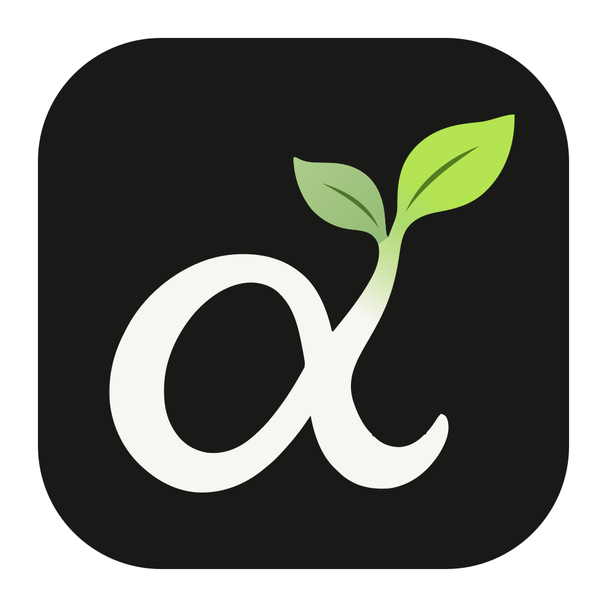
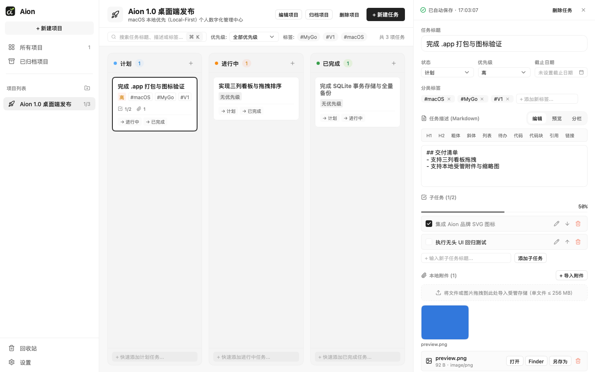

<p align="center">
  
</p>

<h1 align="center">Aion</h1>

<p align="center">
  轻量、纯原生的 macOS 本地项目管理工具。
</p>

<p align="center">
  
  
  <a href="https://mygo.lobehub.com"></a>
</p>

<p align="center">
  
</p>

Aion（读作 `EYE-on`，源自古希腊语 αἰών，意为“生命、时代与永恒”）帮你把日常项目、任务拆解与本地资料收敛在同一处。所有数据 100% 存储在你的 Mac 本地，无需注册账号，不依赖任何云服务，断网环境下依然拥有毫秒级响应。

## 功能

- **三列看板**：围绕“计划 / 进行中 / 已完成”管理项目进度，支持鼠标拖拽跨列流转、列内排序、右键菜单，以及 `⌘K` 搜索、优先级筛选与多标签交集筛选
- **多项目工作区**：统一管理多个活跃项目与已归档项目，左侧导航栏支持拖拽调节宽度与折叠为紧凑图标栏
- **任务详情面板**：支持标题、状态、优先级、截止日期、分类标签编辑与自动保存状态反馈
- **Markdown 编辑与预览**：内置“编辑 / 预览 / 分栏”三种模式切换与快捷语法工具栏，自动持久化原始 Markdown 文本
- **子任务清单**：支持子任务拆分、勾选、重命名、排序与完成度进度条（勾选全部子任务不会强制将父任务标为已完成）
- **本地受管附件**：支持点击选择或直接从 Finder 拖入文件/图片，提供图片缩略图与大图预览、系统默认应用打开、Finder 定位与另存为导出
- **回收站与全量备份**：删除项目与任务默认进入回收站；内置周期性自动备份轮转与手动全量 `.zip` 导出/恢复

## 快速开始

需要 Go 1.27.3 或更新版本。获取仓库代码后进入项目根目录运行：

```bash
cd Aion
go run .
```

如需使用独立的测试数据目录启动（不影响正式数据）：

```bash
go run . -data-dir /tmp/aion-dev
```

## 构建与打包

Aion 使用 `mygo` 直接构建 macOS 原生窗口应用，不打包 Chromium / WebView，也不启动本地 HTTP 服务。

```bash
# 开发模式运行
go tool mygo dev

# 构建 macOS 原生 .app 与 .dmg 安装包（默认输出到 build/darwin-arm64/；Universal 构建可用 -platform darwin/universal）
go tool mygo build

# 为指定数据目录生成无头渲染快照 PNG（1360×860）
go run . -data-dir /tmp/aion-snap -snapshot /tmp/aion-snapshot.png

# 渲染带示例数据的看板/设置视觉快照 PNG（用于视觉回归检查）
AION_SAVE_SNAPSHOT=/tmp/aion-snapshot.png go test ./frontend -run TestVisualSnapshotRender
```

## 数据与备份

默认数据目录位于 macOS 标准应用支持路径：

```text
~/Library/Application Support/Aion/
├── aion.sqlite     # SQLite 主数据库（项目、任务、子任务、标签、回收站、设置）
├── attachments/    # 受管本地附件存储
└── backups/        # 自动快照（auto-*.zip）与恢复前安全备份（safety-*.zip）
```

在左侧导航底部的**设置**（全局设置与数据管理）中可以管理数据生命周期：

- **自动备份**：应用启动及运行期间按周期（默认每天一次、保留最近 7 份）自动生成一致性快照并轮转清理旧备份
- **手动导出**：随时将当前 SQLite 快照、全部受管附件及 `manifest.json` 校验清单打包导出为 `.zip`
- **完整恢复**：恢复前先校验清单、文件 SHA-256 摘要与数据库结构；若备份包损坏则立即中止且不改动现有数据。正式替换前会自动将当前数据打包为一份 `safety-*.zip` 安全备份以便随时回滚

## 安全与隐私

Aion 从架构层保证个人数据完全受你控制：

- **离线优先与最小网络访问**：核心功能离线运行，项目和附件保存在本机；无账号体系、无遥测上报、无第三方云同步。默认仅在用户主动检查或下载安装更新时访问 GitHub 下载服务，不上传项目内容
- **进程内直连**：前端通过 Go 函数调用直接操作本地后端服务，不在本机暴露任何 HTTP 端口
- **受管附件隔离**：导入附件会复制到应用受管目录并记录 SHA-256 摘要，源文件移动或删除不影响应用内预览与打开
- **防误删保护**：项目与任务删除默认进入回收站，关联附件会一并保留，直到在回收站中确认“彻底删除”或“清空回收站”后才会物理移除记录并触发附件垃圾回收（GC）；在任务详情中主动移除单个附件则会直接解除关联并清理未引用文件
- **单实例目录锁**：同一数据目录不可被两个实例同时打开，SQLite 事务与受管附件共享一致性锁，避免备份与编辑交错损坏

## 开发

| 命令 | 用途 |
|---|---|
| `go run .` | 在本地启动 Aion 原生桌面端 |
| `go test ./...` | 运行全部后端与无头 UI 交互测试 |
| `go test -race ./...` | 运行竞态检测测试 |
| `go vet ./...` | Go 静态分析检查 |
| `go tool mygo vet .` | MyGo 布局与状态规则静态检查 |

```text
main.go                              原生窗口宿主入口、应用菜单/更新插件与系统能力桥接
mygo.json                            MyGo 应用配置、打包元数据与更新源配置
CHANGELOG.md                         版本更新说明（发版说明与客户端更新窗口共用）
.github/workflows/release.yml        标签触发的 macOS Universal 构建与草稿 Release 工作流
frontend/                            原生界面层：工作台状态、侧边栏、项目总览、三列看板、任务详情、回收站、设置与附件预览
frontend/workbench_test.go           基于 ui.Tester 的端到端无头 UI 交互测试
frontend/attachment_preview_test.go  图片缩略图解码、方向校正与有界缓存测试
backend/                             后端总入口、模块注册、全局设置与自动备份调度生命周期
backend/integration_test.go          跨目录备份迁移与彻底删除 GC 集成测试
backend/model/                       领域模型、状态枚举与哨兵错误定义
backend/store/                       SQLite 事务、Schema 迁移与读写一致性锁
backend/projects/                    项目、任务、三列移动/排序、搜索筛选与回收站服务
backend/attachments/                 本地受管文件导入、导出、路径解析与孤儿文件 GC
backend/backup/                      全量 ZIP 导出、完整性校验、安全备份与自动轮转
assets/icon/                         Aion 品牌图标源文件（SVG）、打包用 PNG 与 Go 嵌入封装（icon.go）
assets/badges/                       README 徽章图标（Lobe MyGo SVG）
assets/screenshot.png                无头渲染的界面预览截图（1440×900）
```

基于 [MyGo](https://github.com/egoist/mygo)、[Lobe MyGo UI](https://github.com/lobehub/lobe-mygo) 构建。
