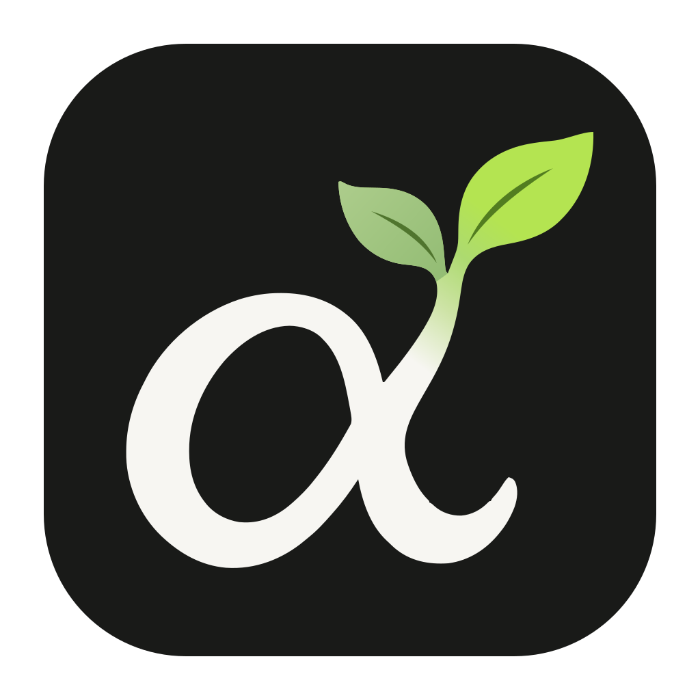
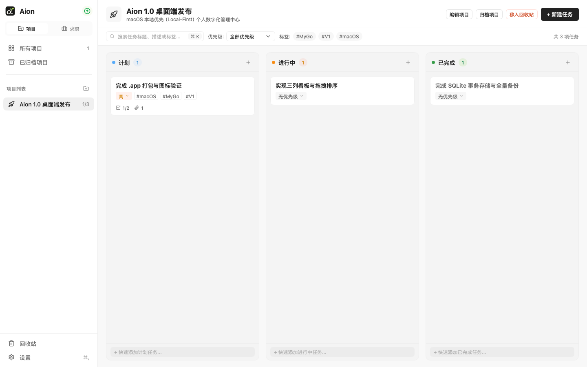

<p align="center">
  
</p>

<h1 align="center">Aion</h1>

<p align="center">
  轻量、纯原生的 macOS 本地项目与求职投递管理工具。
</p>

<p align="center">
  
  
  <a href="https://mygo.run"></a>
</p>

<p align="center">
  
</p>

Aion（读作 `EYE-on`，源自古希腊语 αἰών，意为“生命、时代与永恒”）帮你把日常项目、任务拆解、本地资料与求职投递记录收敛在同一处。所有数据 100% 存储在你的 Mac 本地，无需注册账号，不依赖任何云服务，断网环境下依然拥有毫秒级响应。

## 功能

- **模块化工作台**：侧边栏顶部（展开及折叠态）可在**项目**与**求职**两个独立工作区之间一键切换，各自保留最近页面、搜索与筛选上下文，并共享全局**回收站**与**设置 / 备份**
- **三列看板**：围绕“计划 / 进行中 / 已完成”管理项目进度，支持鼠标拖拽跨列流转、列内排序、右键菜单、点击卡片优先级标签快速切换，以及 `⌘K` 搜索、优先级筛选与多标签交集筛选
- **多项目工作区**：统一管理多个活跃项目与已归档项目，左侧导航栏支持拖拽调节宽度与折叠为紧凑图标栏
- **任务详情弹窗**：点击任务卡片弹出居中的任务详情编辑窗口（不挤压看板列布局），支持标题、状态、优先级、截止日期、分类标签编辑与自动保存状态反馈
- **求职投递记录**：提供“全部投递 / 进行中 / 已获 Offer / 已结束”四个固定视角与全局统计卡片，支持表格横向滚动与行内阶段/状态快速流转、公司/岗位 `⌘K` 搜索与多条件筛选分页、`http/https` 投递链接一键复制与系统浏览器打开，以及同名进行中投递非阻塞提醒
- **投递详情与时间线**：详情弹窗自动串行保存字段草稿，支持“结束流程（含 Offer 结果阶段确认）/ 重新开启”、追加时间线备注以及只写历史不覆盖当前进度的阶段事件补录
- **Markdown 编辑与预览**：内置“编辑 / 预览 / 分栏”三种模式切换与快捷语法工具栏，自动持久化原始 Markdown 文本
- **子任务清单**：支持子任务拆分、勾选、重命名、排序与完成度进度条（勾选全部子任务不会强制将父任务标为已完成）
- **本地受管附件**：支持点击选择或直接从 Finder 拖入文件/图片，提供图片缩略图与大图预览、系统默认应用打开、Finder 定位与另存为导出
- **回收站与全量备份**：删除项目、任务与求职投递默认进入统一回收站（支持按类型筛选、带完整时间线恢复与彻底清除）；内置周期性自动备份轮转与手动全量 `.zip` 导出/恢复

任务与投递详情输入先保留在本地草稿中，后台按顺序自动保存；连续输入只保留最新的待保存版本。保存期间会显示“正在保存”，切换模块、切换项目/记录或关闭详情会在保存成功后执行最后一次请求。保存失败或输入无效时保留草稿；保存尚未完成时，请等待后再退出应用或恢复备份。页面、项目、投递列表与详情在后台加载，较早的加载结果不会覆盖新页面或新输入。

## 快速开始

### 直接使用（推荐）

前往 [GitHub Releases](https://github.com/Games55k/Aion/releases) 下载最新版本的 `.dmg` 安装包，将 `Aion.app` 拖入「应用程序」目录即可使用（支持在设置页检查并安装更新）。

### 从源码运行（开发者）

如需自行构建或二次开发，请准备 Go 1.27.3 或更新版本并克隆仓库：

```bash
git clone https://github.com/Games55k/Aion.git
cd Aion
go run .
```

如需使用独立的测试数据目录启动（不影响正式数据）：

```bash
go run . -data-dir /tmp/aion-dev
```

## 构建与打包

Aion 使用 `mygo` 直接构建 macOS 原生窗口应用，不打包 Chromium / WebView，也不启动本地 HTTP 服务。

```bash
# 开发模式运行
go tool mygo dev

# 构建 macOS 原生 .app 与 .dmg 安装包（默认输出到 build/darwin-arm64/；Universal 构建可用 -platform darwin/universal）
go tool mygo build

# 为指定数据目录生成无头渲染快照 PNG（1360×860）
go run . -data-dir /tmp/aion-snap -snapshot /tmp/aion-snapshot.png

# 渲染带示例数据的看板视觉快照 PNG（1440×900，用于视觉回归检查）
AION_SAVE_SNAPSHOT=/tmp/aion-snapshot.png go test ./frontend -run TestVisualSnapshotRender

# 渲染设置页视觉快照 PNG（1440×1280，可与上一条同时设置）
AION_SAVE_SETTINGS_SNAPSHOT=/tmp/aion-settings.png go test ./frontend -run TestVisualSnapshotRender

# 渲染求职投递列表、窄窗口表格与投递详情视觉快照 PNG（可与其它快照环境变量组合使用）
AION_SAVE_JOBS_SNAPSHOT=/tmp/aion-jobs.png \
AION_SAVE_JOBS_NARROW_SNAPSHOT=/tmp/aion-jobs-narrow.png \
AION_SAVE_JOB_DETAIL_SNAPSHOT=/tmp/aion-job-detail.png \
go test ./frontend -run TestVisualSnapshotRender
```

`-snapshot` 的输出路径必须位于当前数据目录之外（包括经符号链接访问的路径）。快照 PNG 完整写入后才会原子替换已有的普通文件，避免误覆盖数据库、附件或备份。

## 数据与备份

默认数据目录位于 macOS 标准应用支持路径：

```text
~/Library/Application Support/Aion/
├── aion.sqlite     # SQLite 主数据库（Schema v2：项目、任务、子任务、求职投递与时间线、回收站、设置）
├── attachments/    # 受管本地附件存储
└── backups/        # 自动快照（auto-*.zip）与恢复前安全备份（safety-*.zip，保留最近 5 份）
```

在左侧导航底部的**设置**（全局设置与数据管理，也可按 `⌘,` 打开）中可以管理数据生命周期：

- **自动备份**：应用启动及运行期间按周期（默认每天一次、保留最近 7 份）自动生成一致性快照并轮转清理旧备份
- **手动导出**：随时将当前 SQLite 快照、全部受管附件及 `manifest.json` 校验清单打包导出为 `.zip`
- **完整恢复**：恢复前先校验清单、文件 SHA-256 摘要与对应版本数据库结构；支持 Schema v1 与 Schema v2 备份包（旧版 v1 备份会在隔离临时目录校验并迁移升级至 v2 后再二次校验替换）。若备份包损坏或校验失败则立即中止且不改动现有数据；正式替换前会自动将当前数据打包为一份 `safety-*.zip` 安全备份以便随时回滚

自动备份与手动导出只在生成 SQLite 快照、固定附件引用期间占用数据锁，压缩、校验和自动备份轮转在锁外完成。临时附件引用采用同一文件系统的硬链接，保证并发删除附件不会破坏正在生成的备份，完成或取消后会清理。恢复前的安全备份仍与数据替换保持互斥，避免遗漏恢复前最后的修改。

自动备份目录（含默认目录）不能是符号链接，也不能位于受管附件存储内。V1 备份上限为 10,000 个附件、单文件（含数据库快照）256 MiB、解压后总计 2 GiB（导出时预留 2 MiB 清单空间）、ZIP 文件 3 GiB；导入时只检查单附件大小，数据累计超过整包限制后需要另行处理。

彻底删除或清空回收站时，数据库删除与附件文件清理分步完成。若文件清理失败，条目仍会从回收站移除并显示警告；未引用文件会在后续清理操作中重试删除。

## 开发

待实施方案：[开发自动化与 UI 封装精简](docs/plans/automation-and-ui-simplification.md)，按“开发用 Automation → 未使用 UI 能力清理”的顺序推进；其中的 Automation 命令需在接入完成后使用。

| 命令 | 用途 |
|---|---|
| `go run .` | 在本地启动 Aion 原生桌面端 |
| `go test ./...` | 运行入口、后端与无头 UI 交互测试 |
| `go test -race ./...` | 运行竞态检测测试 |
| `go vet ./...` | Go 静态分析检查 |
| `go tool mygo vet .` | MyGo 布局与状态规则静态检查 |

```text
Aion/
├── main.go                                 # 原生窗口宿主入口、应用菜单/更新插件与系统能力桥接
├── main_test.go                            # 快照输出数据保护与原子替换回归测试
├── mygo.json                               # MyGo 应用配置、打包元数据与更新源配置
├── CHANGELOG.md                            # 版本更新说明（发版说明与客户端更新窗口共用）
├── docs/plans/                             # 待实施方案与验收安排（状态以各文档为准）
├── .github/
│   ├── workflows/release.yml               # 标签触发的 macOS Universal 构建与草稿 Release 工作流
│   └── ISSUE_TEMPLATE/                     # GitHub Issue 表单模板与空白 Issue 禁用配置
├── frontend/                               # 原生界面层：工作台状态、模块切换侧栏、项目看板、求职投递、回收站、设置与附件预览
│   ├── ui_*.go / icons.go                  # 基于 MyGo 原生 UI 封装的设计令牌、控件、弹窗、Markdown 与 Lucide SVG 图标
│   ├── sidebar.go                          # 展开/折叠双形态模块切换器与各模块导航侧栏
│   ├── task_save.go                        # 任务草稿串行保存、合并输入与保存后的导航
│   ├── job_save.go                         # 求职投递详情草稿校验、串行保存与撤销恢复
│   ├── job_controller.go                   # 求职投递筛选、分页、流转、备注、补录与回收站动作控制
│   ├── job_applications_view.go            # 求职投递主视图、统计摘要、响应式表格与新增弹窗
│   ├── job_application_detail_view.go      # 求职投递详情弹窗、流程时间线、备注/补录表单与结束流程弹窗
│   ├── workbench_load.go                   # 后台加载与过期结果保护
│   ├── async_persistence_test.go           # 长持锁输入/导航、保存失败与并发回调回归测试
│   ├── workbench_test.go                   # 基于 ui.Tester 的端到端无头 UI 交互测试
│   └── attachment_preview_test.go          # 图片缩略图解码、方向校正与有界缓存测试
├── backend/                                # 后端总入口、模块注册、全局回收站分发、设置与自动备份调度生命周期
│   ├── integration_test.go                 # 跨目录备份迁移、跨模块回收站分发与彻底删除 GC 集成测试
│   ├── model/                              # 领域模型（项目/任务、求职投递与事件）、状态枚举与哨兵错误定义
│   ├── store/                              # SQLite 事务、Schema v1→v2 迁移与读写一致性锁
│   ├── projects/                           # 项目、任务、三列移动/排序、搜索筛选与回收站服务
│   ├── jobapplications/                    # 求职投递记录、事件去重、筛选排序统计、补录与回收站服务
│   ├── attachments/                        # 本地受管文件导入、导出、路径解析与孤儿文件 GC
│   └── backup/                             # 全量 ZIP 导出、v1/v2 完整性校验、安全备份与自动轮转
└── assets/
    ├── icon/                               # Aion 品牌图标源文件（SVG）、打包用 PNG 与 Go 嵌入封装（icon.go）
    └── screenshot.png                      # 无头渲染的界面预览截图（1440×900）
```

基于 [MyGo](https://github.com/egoist/mygo) 原生 UI 构建。

Apple 公证优先使用完整的 API Key 三项凭据，否则使用已通过校验的 Apple ID 凭据；临时签名钥匙串从创建前即登记清理路径，后续导入或公证失败时也会清理。
